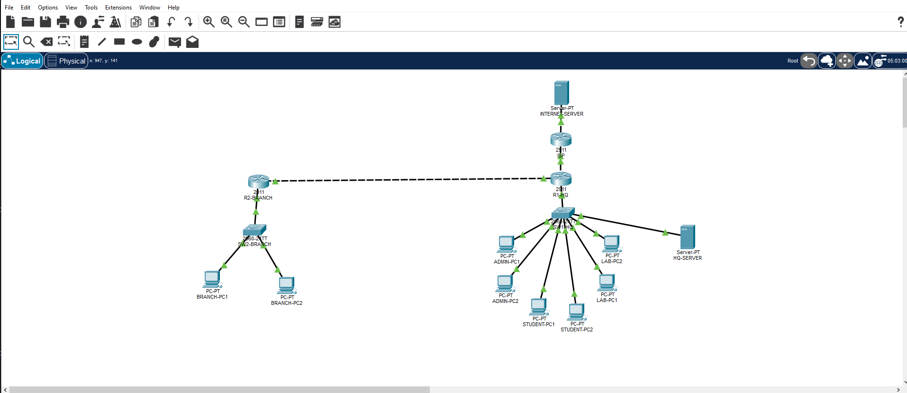
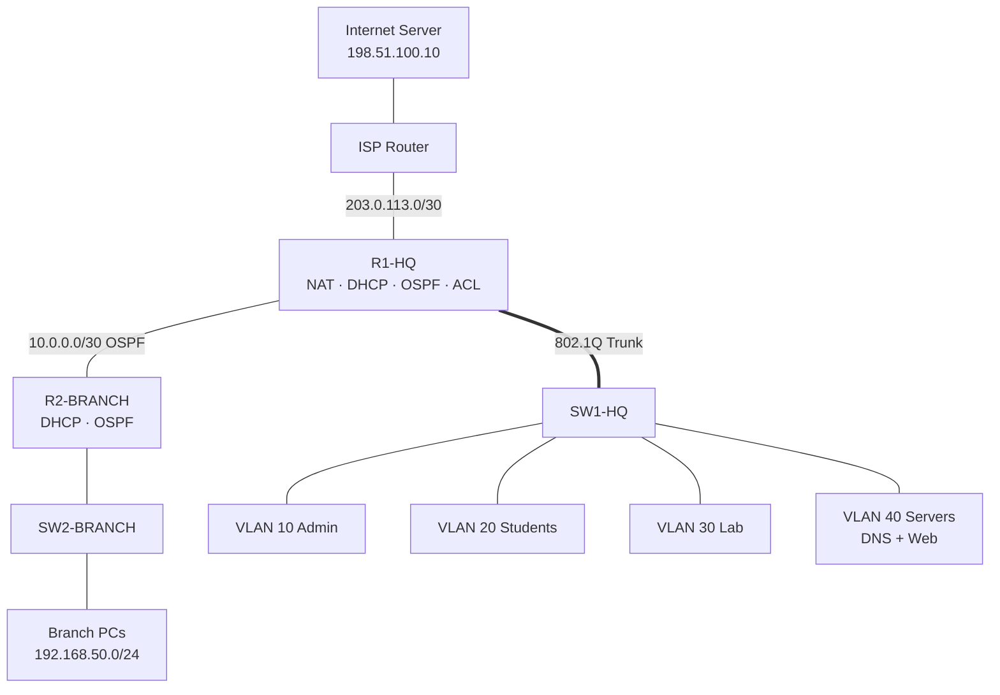

# 🏫 Enterprise Campus Network: Design, Security and Automation

A complete multi-site enterprise network built in **Cisco Packet Tracer**, with
**Python** network-automation tools and a **C++** OSPF shortest-path simulator.


---

## 📌 Overview

The network connects a **headquarters campus** (4 departments in separate VLANs) to a
**branch office** and the **Internet**. It is designed to be secure, scalable and
easy to manage.

| Feature | Technology used |
|---|---|
| Network segmentation | VLANs 10/20/30/40/99, 802.1Q trunking |
| Inter-VLAN routing | Router-on-a-stick (subinterfaces) |
| Dynamic routing | OSPF single area, default-route propagation |
| Automatic addressing | DHCP server on routers (one pool per VLAN) |
| Internet access | NAT/PAT overload, default static route |
| Name resolution and web | DNS and HTTP server |
| Security | Extended ACL (students ↛ admin), VTY ACL, SSH v2, port security, unused ports shut down |
| Automation | Python config generator and VLSM planner |
| Routing algorithm | C++ Dijkstra (SPF) simulator with link-failure testing |

## 🗺️ Topology





## 📋 IP Addressing Plan

| Network | VLAN | Subnet | Gateway | Notes |
|---|---|---|---|---|
| Admin | 10 | 192.168.10.0/24 | 192.168.10.1 | DHCP |
| Students | 20 | 192.168.20.0/24 | 192.168.20.1 | DHCP, restricted by ACL |
| Lab | 30 | 192.168.30.0/24 | 192.168.30.1 | DHCP |
| Servers | 40 | 192.168.40.0/24 | 192.168.40.1 | Server = .10 (static) |
| Management | 99 (native) | 192.168.99.0/24 | 192.168.99.1 | SW1 = .2 |
| Branch LAN | - | 192.168.50.0/24 | 192.168.50.1 | DHCP from R2 |
| R1 ↔ R2 | - | 10.0.0.0/30 | - | OSPF area 0 |
| R1 ↔ ISP | - | 203.0.113.0/30 | 203.0.113.1 | Public / NAT outside |
| Internet | - | 198.51.100.0/24 | 198.51.100.1 | Internet server .10 |

## 📁 Repository Structure

```
├── Campus-Network.pkt        # Packet Tracer file (open with Packet Tracer 8.x)
├── configs/                  # Full CLI config of every device
│   ├── R1-HQ.txt  R2-BRANCH.txt  ISP.txt
│   ├── SW1-HQ.txt  SW2-BRANCH.txt
│   └── SERVERS-and-PCs.md
├── docs/BUILD_GUIDE.md       # Step-by-step build + test + troubleshooting
├── python/
│   ├── subnet_planner.py     # Subnet calculator + VLSM planner
│   ├── config_generator.py   # JSON plan -> Cisco IOS config
│   ├── network_plan.json
│   └── test_tools.py         # Unit tests
├── cpp/
│   ├── ospf_simulator.cpp    # Dijkstra SPF routing simulator
│   └── topology.txt
└── screenshots/
```

## ✅ Verification Results

| Test | Result |
|---|---|
| PCs receive IPs via DHCP | ✅ |
| Inter-VLAN ping (Admin → Lab) | ✅ |
| HQ ↔ Branch via OSPF | ✅ |
| Internet access through NAT | ✅ |
| `www.campus.local` resolves and loads | ✅ |
| Student → Admin ping **blocked** by ACL | ✅ (blocked as designed) |
| SSH from Admin allowed, from Students denied | ✅ |


## 🐍 Python Tools

No external libraries are needed (standard library only).

```bash
cd python

# Subnet info
python subnet_planner.py info 192.168.20.0/24

# VLSM: split a /22 among departments by host count
python subnet_planner.py vlsm 192.168.0.0/22 ADMIN:50 STUDENTS:300 LAB:100 SERVERS:10

# Generate router + switch configs from network_plan.json
python config_generator.py

# Run the unit tests
python -m unittest test_tools.py
```

Sample VLSM output:
```
  Name         Needed  Usable  Subnet              Mask             Gateway
  STUDENTS        300     510  192.168.0.0/23      255.255.254.0    192.168.0.1
  LAB             100     126  192.168.2.0/25      255.255.255.128  192.168.2.1
  ADMIN            50      62  192.168.2.128/26    255.255.255.192  192.168.2.129
  SERVERS          10      14  192.168.2.192/28    255.255.255.240  192.168.2.193
```

## ⚙️ C++ OSPF Simulator

Implements **Dijkstra's Shortest Path First** algorithm, the same algorithm OSPF routers
use, to build routing tables and re-converge after a link failure.

```bash
cd cpp
g++ -std=c++17 -Wall -O2 ospf_simulator.cpp -o ospf_simulator
./ospf_simulator topology.txt
```

```
ospf> fail R1-HQ R3-DC
%OSPF-5-ADJCHG: link R1-HQ <-> R3-DC is DOWN. Recalculating SPF...
ospf> table R1-HQ
  Destination   Next hop      Cost   Path
  R3-DC         R2-BRANCH     11     R1-HQ -> R2-BRANCH -> R3-DC
  R4-BRANCH2    R2-BRANCH     12     R1-HQ -> R2-BRANCH -> R3-DC -> R4-BRANCH2
```

## 🚀 How to Run the Network

1. Install [Cisco Packet Tracer](https://www.netacad.com/) (free with a NetAcad account).
2. Open `Campus-Network.pkt`.
3. Wait about 30 seconds (or click Fast Forward Time) for OSPF and DHCP to converge.
4. Try the tests in [`docs/BUILD_GUIDE.md`](docs/BUILD_GUIDE.md#step-6-test-everything-and-screenshot-the-results).

Default credentials (lab only): `admin` / `Admin@123`, enable secret `Cisco@123`.

## 📚 What I Learned

- Designing a hierarchical, segmented network and planning IP addressing with VLSM
- Configuring VLANs, trunks, inter-VLAN routing, OSPF, DHCP, NAT and ACLs on Cisco IOS
- Hardening devices: SSH, port security, restricting management access
- Automating configuration with Python, and why automation reduces human error
- How link-state routing protocols compute paths (Dijkstra) and re-converge

## 🔮 Future Improvements

- Add HSRP for gateway redundancy, and a second core switch
- Add a wireless network (WLC + LAP) for students
- Add an IPv6 dual-stack
- Push generated configs to real devices with Netmiko

## 👤 Author

**Abdullah Tanveer** · [LinkedIn](https://www.linkedin.com/in/abdullahtanveer-it) · [GitHub](https://github.com/abdullahtanveer004-dev)
